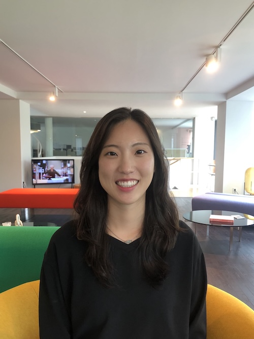

  

# Minjin Chae

PhD Candidate, Harvard University, Department of Sociology

email: **minjinchae@g.harvard.edu**

I study who gains control over where and when work occurs, and who benefits when work becomes flexible. The technical conditions of work, such as tasks and technologies, tell only part of the story. My research shows that social structures, including gender norms, racial task segregation, and worker power, are equally consequential. These structures explain why new forms of work keep reproducing old inequalities of gender, race, and class. My current projects ask whether workplace flexibility shifts gendered domestic expectations, how racial task segregation determines who can work from home, why schedule control operates as a temporal rent, and when expanded flexibility advances female employees' careers. To answer these questions, I draw on experimental, survey, and administrative data from the United States, Germany, and South Korea.

Here's [my CV](Chae_CV.pdf).

## Publications

<ul class="publications">
  <li>Yun, Youngho, Yeani Choi, and Minjin Chae. 2021. "Development and Validity Testing of the Workplace Parentship Index (WPI): Assessment of Family-Friendly Practices." <i>Journal of Occupational and Environmental Medicine</i> 63(12).</li>
</ul>

## Working papers

<ul class="publications">
  <li>Chae, Minjin. "When Does Gender Trump Flexibility? Workplace Flexibility and Domestic Task Assignment." Under review.
    <ul class="award">
      <li>Finalist, Best Student Paper Award, Organization and Management Theory Division, Academy of Management, 2026</li>
    </ul>
  </li>
</ul>

## Work in progress

<ul class="publications">
  <li>Chae, Minjin. "Activating Inequality: Task Segregation and the Racial and Gender Divide in Remote Work."</li>
  <li>Chae, Minjin. "When Do Firms Reduce or Reproduce Gender Inequality? Organizational Contexts of the Pandemic Work From Home and KiF&ouml;G Childcare Expansions."
    <ul class="award">
      <li>Guest Researcher in residence, WZB Berlin Social Science Center, Spring 2026</li>
    </ul>
  </li>
  <li>Chae, Minjin. "Worker Power and Temporal Rents: How Occupational Closure and Productivity Constraints Shape Schedule Control."</li>
  <li>Cha, Youngjoo, Kaitlin Johnson, and Minjin Chae. "It's the Hours, Not the Job: Temporal Flexibility and the Gender Wage Gap Within Occupations."</li>
  <li>Chae, Minjin. "Who Works From Home Within the Same Job? Racial Inequality in Remote Work and the Role of Collective Bargaining."</li>
  <li>Chae, Minjin. "Gender Essentialist Norms and Skeptical Attitudes Toward Marriage Among South Korean Young Adults."
    <ul class="award">
      <li>International Conference on Sociology of Korea Student Paper Award, University of Pennsylvania Kim Center for Korean Studies, 2022</li>
      <li>Best Graduate Student Paper Award, The Population Association of Korea, 2019</li>
    </ul>
  </li>
</ul>

